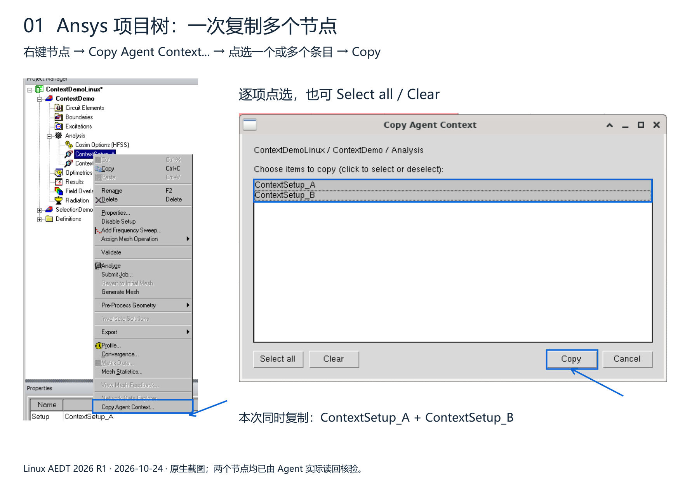
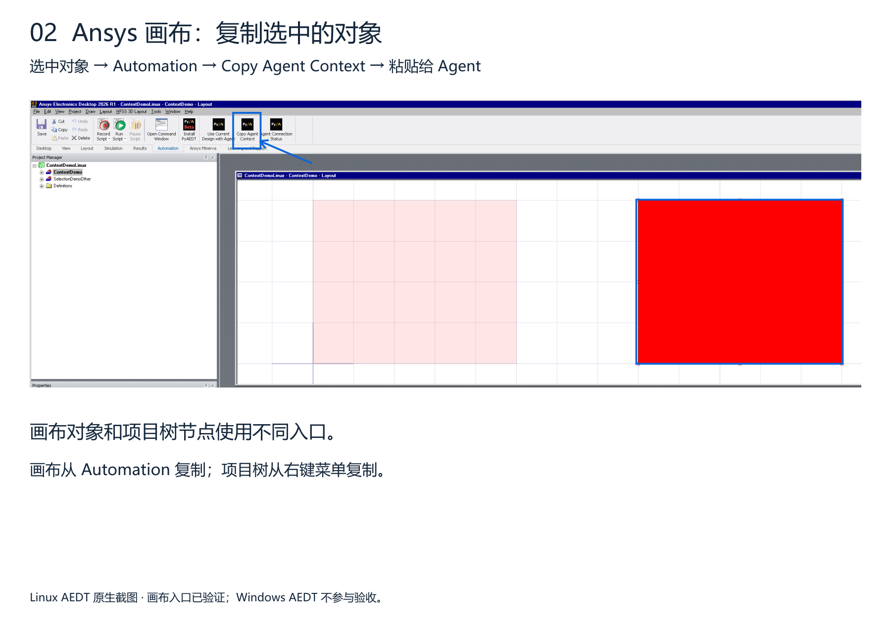

# Copy Ansys context

[Download the illustrated guide (PDF)](context-guide.pdf).

Select multiple items by clicking each row, then click **Copy**. **Select all** and **Clear** are also available. Each copied item retains its full project/design path.

Paste the complete copied text into your Agent input and add your request. The input illustration below abbreviates JSON for readability; do not paste the abbreviated example.

Verified in Linux AEDT 2026 R1: both selected Setup paths were copied and independently read back through MCP. The canvas page shows the previously accepted selection workflow.
